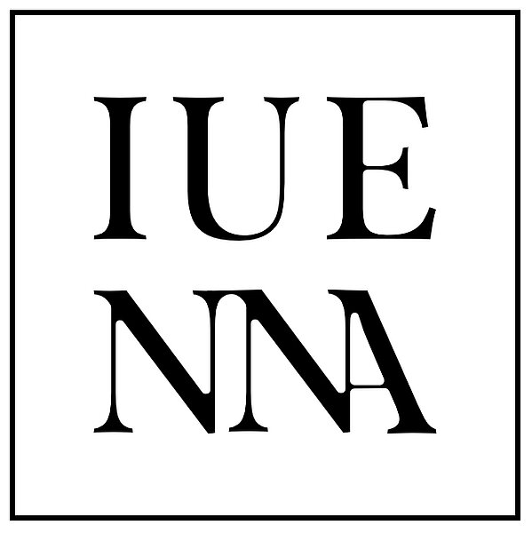

    
    <h1>openIng the soUthErn jauNtal as a micro-regioN for future Archaeology</h1>

## Project Framework

**IUENNA** was an innovative project aimed at advancing the use of digital methods in Austrian archaeology. By addressing complex cultural-historical questions, actively shaping the Digital Humanities in Classical Studies, and ensuring the long-term preservation of cultural heritage, IUENNA contributed to sustainable knowledge management. The project focused on the archaeological micro-region of the Jauntal (Carinthia, Austria).

IUENNA was jointly hosted by [kärnten.museum](https://landesmuseum.ktn.gv.at) and the [Austrian Archaeological Institute (OeAI)](https://www.oeaw.ac.at/oeai) at the [Austrian Academy of Sciences (OeAW)](https://www.oeaw.ac.at/). Further project partners and contributing institutions included the [Austrian Centre for Digital Humanities (ACDH)](https://www.oeaw.ac.at/acdh), the [Federal Monuments Authority (BDA)](https://bda.gv.at/), and [ARDIG](https://www.ardig.at/). It employed a comprehensive open-science approach to establish a model study for the long-term digital preservation of archaeological data and cultural insights.

## Funding

IUENNA was funded by the **Austrian Academy of Sciences (OeAW)** through the [Go!Digital 3.0 programme](https://www.oeaw.ac.at/foerderungen/godigital/godigital-30) (project **GD3.0_2021-24_IUENNA**).

## Project Leadership

- **[Dominik Hagmann](https://orcid.org/0000-0002-4481-6234)** – Project Coordinator and Principal Investigator, [kärnten.museum](https://landesmuseum.ktn.gv.at)
- **Franziska Waldhart** – Principal Investigator, [OeAI](https://www.oeaw.ac.at/oeai) / [OeAW](https://www.oeaw.ac.at/)

## About This GitHub Page

This page provides simple and reusable web applications to demonstrate practical use cases for managing, exploring, and sustainably archiving archaeological data:

- **[Web Mapping Application (WMA)](https://iuenna.github.io/wma/wma.html)**: Interactive spatial exploration of over 20,000 digitized and georeferenced archaeological resources across the Jauntal micro-region.
- **[IUENNA Knowledge Graph & Corpus Explorer](https://iuenna.github.io/graph/index.html)**: Interactive semantic network and corpus explorer (powered by Cytoscape.js) covering the complete IUENNA repository on ARCHE (ACDH / OeAW) with all 20,788 entries (247 collections and 20,541 primary resources / 356.68 GB), folder structures, research institutions, actors, spatial locations, epochs, and licenses.
- **[Ask IUENNA – technical documentation](ASK_IUENNA.md)**: Client-side conversational discovery over ARCHE-derived metadata with deterministic entity resolution, multilingual place aliases, intent detection and session-based dialogue context.
- **[ARCHE Repository Collection](https://id.acdh.oeaw.ac.at/iuenna)**: Direct access to the authoritative, FAIR-compliant long-term archive repository ([PID: 21.11115/0000-0016-7B39-F](https://hdl.handle.net/21.11115/0000-0016-7B39-F)).

## What Can You Do with the Data? (Practical Use Cases)

The IUENNA project provides open, citable, and machine-readable archaeological data structured for diverse research and computational workflows:

1. **AI Agents & LLMs (Remote MCP & BYOAI)**:
   - Connect your AI assistant (Claude Desktop, Cursor, Antigravity, ChatGPT) to the public Remote MCP endpoint: `https://iuenna-mcp.dominik-hagmann13.workers.dev/mcp`
   - Ask complex natural language research questions, retrieve primary excavation documentation with persistent identifiers (ARCHE PIDs), and traverse graph neighborhoods without API keys.
2. **Quantitative Data Science & Python Scripting**:
   - Query all 219 georeferenced archaeological findspots via [`data/arche_places.json`](https://iuenna.github.io/data/arche_places.json) or the 20,355-file corpus via [`data/arche_corpus.json`](https://iuenna.github.io/data/arche_corpus.json) using Python's standard library (`urllib.request`, `json`) without external dependencies.
3. **Spatial GIS & Bioarchaeological Modeling (QGIS & GeoPandas)**:
   - Load the 9 curated OGC GeoPackages (e.g. `glo_graeber-anthropologie.gpkg` with radiocarbon dates, cranial deformations, and grave goods, or `glo_geodaten_open.gpkg` with georadar prospections) directly into QGIS or GeoPandas.
4. **Knowledge Graphs & Semantic Network Analysis**:
   - Explore and analyze the 21,332-node and 282,116-edge semantic graph in Cytoscape or Gephi to trace connections between archaeologists, institutions, findspots, and archival records.

👉 For copy-paste ready prompts and code recipes, see the **[BYOAI Guide & Recipes](https://iuenna.github.io/byoai.html#use-cases)**.

## Learn More on Our Website

Visit our dedicated project page at [iuenna.hypotheses.org](https://iuenna.hypotheses.org).

---
[Legal Notice](https://iuenna.github.io/impressum-datenschutz) | [Privacy Policy](https://iuenna.github.io/impressum-datenschutz) | [CC BY 4.0](https://creativecommons.org/licenses/by/4.0/)
